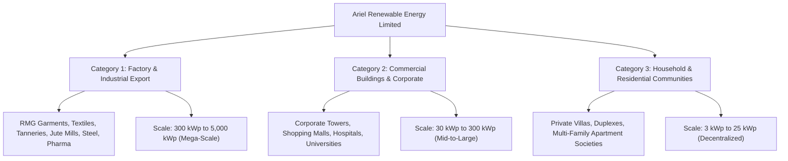
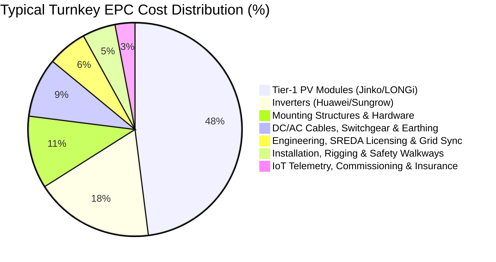

# Ariel Renewable Energy Limited
## Sovereign Green Infrastructure & Industrial Decarbonization
### Comprehensive Customer Packages, Technical Specifications, Costing & Psychological Pitch Masterclass

---

> **Corporate Legal Entity**: Ariel Renewable Energy Limited  
> **Parent Group**: ArielMC (Ariel Marketing & Communications Limited)  
> **Business Sector**: Energy  
> **Product**: Solar (Turnkey C&I Factory Rooftop Solar EPC, Commercial Rooftops & Residential Solar Infrastructure)  
> **Primary Web Portal**: `https://energy.arielmc.com`  
> **Technical Hub & CRM**: `https://energy.arielmc.com/crm`  
> **Applicable Policies**: SREDA Net-Metering Guidelines (Tk 10.50/kWh Grid Buyback), Bangladesh Bank 4.5% Green Refinancing Facility, 1% Fiscal Customs Duty on Tier-1 Equipment, 10-Year Corporate Tax Holiday.

---

## Executive Summary & Market Segmentation

Ariel Renewable Energy Limited approaches the national clean energy transition through three distinct customer categories:



---

# SECTION A: Commercial Packages Matrix (All 3 Customer Categories)

## 1. Category 1: Factory & Industrial Export Manufacturers

| Package Tier | Package Name | Target Capacity | Target Client Base | Key Features | Financing & Delivery |
| :--- | :--- | :--- | :--- | :--- | :--- |
| **Tier 1.1** | **Sovereign Export Prime** *(Turnkey Grid-Tied)* | 300 kWp – 2,500 kWp | RMG Garment Mills, Composite Knitwear, Woven Apparel, Jute Mills | • Zero-penetration standing seam PEB mounting<br/>• SREDA 11 kV/33 kV bi-directional grid sync<br/>• Accord/RSC 1.2m fire safety walkways<br/>• Tier-1 N-Type TOPCon bifacial modules | **Zero Working Capital**:<br/>• 80% Bangladesh Bank 4.5% Green Debt<br/>• 20% Milestone EPC credit<br/>• Payback: 3.2 – 3.6 Years |
| **Tier 1.2** | **Industrial Hybrid Resilient** *(Solar + BESS Storage)* | 500 kWp – 3,000 kWp + 500 kWh – 2,000 kWh BESS | Continuous Process Textile Dyeing, Ceramic Kilns, Pharmaceuticals | • Sub-20 millisecond UPS backup switchover<br/>• Peak-demand tariff shaving (5 PM – 11 PM)<br/>• Slashes diesel generator fuel run costs by up to 75%<br/>• Heavy-duty Lithium Iron Phosphate (LiFePO4) storage | • Concessionary green debt structuring<br/>• O&M telemetry monitoring SLA<br/>• Payback: 3.8 – 4.4 Years |
| **Tier 1.3** | **LEED Carbon-Shield & I-REC Accelerator** | 500 kWp – 5,000 kWp | Export Manufacturers targeting LEED Platinum / US & EU Buyer Audits | • Revenue-grade automated energy accounting<br/>• Blockchain-verified I-REC certificate issuance<br/>• EU CBAM carbon border tax exemption reporting<br/>• Live buyer ESG carbon audit portal integration | • Turnkey EPC + 10-Year O&M guarantee<br/>• Dedicated carbon compliance officer<br/>• Payback: 3.1 – 3.5 Years |

---

## 2. Category 2: Commercial Buildings & Corporate Centers

| Package Tier | Package Name | Target Capacity | Target Client Base | Key Features | Benefits & Impact |
| :--- | :--- | :--- | :--- | :--- | :--- |
| **Tier 2.1** | **Corporate Prestige Elevated Pergola** | 30 kWp – 150 kWp | Corporate Headquarters, High-Rise Towers (Gulshan/Tejgaon), Bank HQs | • 8-foot elevated hot-dip galvanized structural canopy<br/>• **100% roof floor area preserved** for executive gardens & cafes<br/>• High-aesthetic double-glass bifacial solar modules<br/>• Slashes common building electricity bill by 45% – 60% | • High-visibility architectural green statement<br/>• Zero loss of valuable rooftop usable space<br/>• Payback: 3.5 – 3.9 Years |
| **Tier 2.2** | **Retail & Mall Peak-Demand Shaver** | 100 kWp – 400 kWp | Shopping Complexes, Convention Centers, Superstores | • Designed to directly counter high daytime AC chiller loads<br/>• High commercial tariff substitution (Tk 13.50 – 15.00/kWh)<br/>• Multi-MPPT commercial string inverters<br/>• Real-time tenant power allocation sub-metering | • **Fastest payback in Bangladesh** (3.0 – 3.4 Years)<br/>• Generates immediate monthly operating surplus |
| **Tier 2.3** | **Healthcare & Critical Care Solar-Hybrid** | 50 kWp – 250 kWp + 100 kWh – 500 kWh BESS | Private Hospitals, Diagnostic Centers, Cold Storage Labs | • Medical-grade voltage stabilization & harmonic filtration<br/>• Instantaneous battery backup for ICUs and operation theaters<br/>• Seamless diesel generator bridging reducing fuel costs | • Uninterrupted life-support reliability<br/>• Hedge against sudden utility power blackouts |

---

## 3. Category 3: Households & Residential Communities

| Package Tier | Package Name | Target Capacity | Target Client Base | Key Features | Family & Community Value |
| :--- | :--- | :--- | :--- | :--- | :--- |
| **Tier 3.1** | **Urban Home Freedom** *(Duplex / Villa)* | 3 kWp – 6 kWp | Private Family Houses, Duplexes, Bungalows in Urban Dhaka/Ctg | • Eliminates high residential tariff consumption slabs (Tk 12 – 14.50/unit)<br/>• Smart hybrid inverter with smartphone app telemetry<br/>• Compact footprint: Only 250 to 450 sq.ft roof space needed | • Slashes monthly family power bills by up to 80%<br/>• Free power for air-conditioners during peak sun<br/>• Payback: 4.0 – 4.5 Years |
| **Tier 3.2** | **Apartment Community Common-Load Sovereign** | 10 kWp – 30 kWp | Multi-family Apartment Buildings, Housing Societies (6 to 15 Floors) | • Exclusively powers building common utilities: Elevators (lifts), deep-tube-well water pumps, stairwell lights & CCTV<br/>• Shared investment model among flat owners<br/>• Non-penetrative ballast mounting protecting roof waterproofing | • **Permanently slashes monthly flat maintenance service charges** by 40% – 55% for all families<br/>• Eliminates society budget conflicts |
| **Tier 3.3** | **Ariel Solar Gazebo & Garden Canopy** | 5 kWp – 12 kWp | Residential roofs with prized rooftop gardens, patios & tea sit-outs | • Elevated 9-foot architectural pergola structure<br/>• Double-glass frameless bifacial solar modules creating high-end patio shade<br/>• Rainproof and weatherproof comfortable outdoor seating area below | • Protects rooftop plants from scorching midday heat<br/>• Creates an elegant outdoor living and barbecue room<br/>• Beautiful aesthetic addition to the home |

---

# SECTION B: Detailed Specifications & Multi-Option Hardware Choices

Ariel Renewable Energy Limited does not force a single rigid bill-of-materials onto clients. Instead, we offer a **Bankable Multi-Tiered Selection Architecture** based on budget, roof geometry, and engineering preferences:

```
┌────────────────────────────────────────────────────────────────────────┐
│                        HARDWARE SELECTION MATRIX                       │
├─────────────────┬──────────────────────────┬───────────────────────────┤
│ COMPONENT       │ TIER-1 FLAGSHIP OPTION   │ VALUE-ENGINEERED OPTION   │
├─────────────────┼──────────────────────────┼───────────────────────────┤
│ PV Modules      │ JinkoSolar Tiger Neo     │ LONGi Solar Hi-MO X6      │
│                 │ (585W–600W TOPCon N-Type)│ (580W–595W HPBC / TOPCon) │
├─────────────────┼──────────────────────────┼───────────────────────────┤
│ Inverters       │ Huawei SUN2000 Series    │ Sungrow SG Commercial     │
│                 │ (AI Arc Fault Detection) │ (High DC/AC Ratio 1.5)    │
├─────────────────┼──────────────────────────┼───────────────────────────┤
│ Mounting Rack   │ Anodized AL6005-T5       │ Hot-Dip Galvanized Steel  │
│                 │ (Zero Roof Holes Clamps) │ (80µm Zinc Coating)       │
├─────────────────┼──────────────────────────┼───────────────────────────┤
│ Energy Storage  │ CATL / BYD LiFePO4       │ Pylontech / Deye Modular  │
│                 │ (6,000 Cycle Life, 0.5C) │ (Scalable Rack Modules)   │
├─────────────────┼──────────────────────────┼───────────────────────────┤
│ Telemetry       │ Ariel-SaaS™ 4G IoT Gateway│ Smart Dongle + Modbus RTU │
└─────────────────┴──────────────────────────┴───────────────────────────┘
```

### 1. Photovoltaic (PV) Module Specifications
- **Option 1 (Flagship N-Type TOPCon)**: **JinkoSolar Tiger Neo N-Type Bifacial (585W – 600W)**
  - Cell Technology: N-Type TOPCon (Tunnel Oxide Passivated Contact).
  - Module Efficiency: `22.8% – 23.2%`.
  - Bifaciality Factor: `80% ± 5%` (generates additional 5% – 25% energy from rear ground reflection).
  - Temperature Coefficient ($P_{max}$): `-0.30% / °C` (crucial for maintaining high power output in hot Bangladesh summers).
  - Warranties: **12-Year Product Workmanship Guarantee** + **30-Year Linear Power Output Warranty** (guaranteed $\ge 87.4\%$ output at Year 30).
  - Annual Degradation: Year 1: $\le 1.0\%$; Year 2–30: $\le 0.40\% / \text{year}$.

- **Option 2 (Industrial Dual-Glass)**: **LONGi Solar Hi-MO X6 / Hi-MO 7 (580W – 595W)**
  - Cell Technology: Hybrid Passivated Back Contact (HPBC) / N-Type.
  - Mechanical Load: Certified to withstand 5,400 Pa front snow/wind load and 2,400 Pa rear wind load.
  - Fire Rating: Class A fire safety rating with dual-tempered 2.0mm glass.
  - Anti-PID: Industry-leading resistance to Potential Induced Degradation under humid Bangladesh monsoon conditions.

- **Option 3 (Architectural Double-Glass for Gazebos & Canopies)**: **Trina Solar Vertex N Dual-Glass**
  - Aesthetic semi-transparent glass-glass design ideal for residential pergolas, allowing soft diffused light beneath while absorbing high irradiance.

### 2. Inverter & Power Electronics Specifications
- **Commercial & Industrial Scale**:
  - **Huawei SUN2000 Series (50KTL / 100KTL / 115KTL-M2)**:
    - Max Efficiency: `98.8%` (European Efficiency: `98.4%`).
    - Smart Features: AI-powered Arc Fault Circuit Interrupter (AFCI) that automatically disconnects arcing within 0.5 seconds (protects factory roofs from fire).
    - Ingress Protection: IP66 rated for extreme tropical outdoor installation.
    - String-level Smart I-V Curve Diagnosis: Scans thousands of PV modules in 15 minutes to pinpoint shaded or damaged panels remotely without climbing roofs.
  - **Sungrow SG Series (SG110CX / SG125HX)**:
    - High DC/AC overload ratio up to 150%.
    - Built-in Type II DC and AC Surge Protection Devices (SPD).
    - Intelligent forced air cooling preventing thermal derating up to 50°C ambient temperature.

- **Residential & Commercial Hybrid Scale**:
  - **Deye / Growatt Three-Phase Hybrid (5 kW – 50 kW)**:
    - Simultaneous grid-tied export + critical battery backup.
    - Generator auto-start contact for automated diesel generator synchronizing.
    - Frequency shift peak-shaving algorithm.

### 3. Mounting Systems & Structural Engineering
- **PEB Standing Seam Roofs (Factories)**:
  - Material: High-grade Anodized Extruded Aluminum `AL6005-T5` with `SUS304` stainless steel fasteners.
  - Clamping Mechanism: Non-penetrative clamp-on brackets matching exact standing seam profiles (Klip-Lok 406/700, Seamlock).
  - **Strict Guarantee: 100% Zero Roof Holes drilled into factory shed roofs.**
  - Leak Proofing: High-density EPDM vulcanized isolation gaskets.
- **RCC Flat Roofs (Commercial Towers & Residential)**:
  - *Elevated Pergola*: Structural hot-dip galvanized steel columns (`IS 2062` / `ASTM A36`) with $\ge 80 \mu\text{m}$ zinc coating, elevated 8 to 9 feet above roof slab. Certified against coastal cyclonic wind speeds up to $210 \text{ km/h}$.
  - *Non-Penetrative Ballasted System*: Pre-cast concrete ballast blocks on UV-resistant ethylene-propylene-diene (EPDM) mats, requiring zero anchor penetrations into the building waterproof roof membrane.

### 4. Switchgear, Cabling & Safety Standard
- DC Solar Cable: TUV Rheinland certified `EN 50618` halogen-free, cross-linked polyolefin (XLPO) $4\text{mm}^2 / 6\text{mm}^2$ copper cables rated for 1500V DC and 120°C thermal endurance.
- AC Switchgear: Schneider Electric / ABB / Siemens molded case circuit breakers (MCCB), motorized disconnectors, and Type 1+2 surge protection devices.
- Earthing System: Dedicated chemical earth pits with conductive grounding compound achieving **measured earthing resistance $< 0.8\text{ Ohm}$** (substantially surpassing the BNBC $< 5.0\text{ Ohm}$ baseline).
- Walkways & Fire Safety: Accord & RSC standard 1.2-meter anti-slip aluminum walkway grating with safety perimeter handrails for clean O&M and fire-fighter access.

---

# SECTION C: Costing Models & Detailed Price Breakdown

## 1. Commercial Benchmark Costing by Customer Category

```
┌───────────────────────────────┬───────────────────────────────┬──────────────────────────────┐
│ CUSTOMER CATEGORY             │ SYSTEM CAPACITY               │ ESTIMATED TURNKEY COST       │
├───────────────────────────────┼───────────────────────────────┼──────────────────────────────┤
│ Industrial Factory (C&I Mega) │ 500 kWp                       │ ৳ 2,60,00,000 (৳ 52 / Watt)  │
│                               │ 1,000 kWp (1.0 MWp)           │ ৳ 5,00,00,000 (৳ 50 / Watt)  │
│                               │ 2,000 kWp (2.0 MWp)           │ ৳ 9,80,00,000 (৳ 49 / Watt)  │
├───────────────────────────────┼───────────────────────────────┼──────────────────────────────┤
│ Commercial Building           │ 50 kWp                        │ ৳ 31,00,000   (৳ 62 / Watt)  │
│                               │ 100 kWp                       │ ৳ 58,00,000   (৳ 58 / Watt)  │
│                               │ 250 kWp                       │ ৳ 1,40,00,000 (৳ 56 / Watt)  │
├───────────────────────────────┼───────────────────────────────┼──────────────────────────────┤
│ Household / Residential       │ 3 kWp (Grid-Tied)             │ ৳ 2,25,000    (৳ 75 / Watt)  │
│                               │ 5 kWp (Grid-Tied)             │ ৳ 3,60,00,0   (৳ 72 / Watt)  │
│                               │ 10 kWp (Common-Load Society)  │ ৳ 6,80,000    (৳ 68 / Watt)  │
│                               │ 10 kWp (Pergola Gazebo Lux)   │ ৳ 8,20,000    (৳ 82 / Watt)  │
└───────────────────────────────┴───────────────────────────────┴──────────────────────────────┘
```

## 2. Standard Bill of Quantities (BOQ) Percentage Breakdown



## 3. Financial Cashflow & Return On Investment (ROI) Matrix

### Model Case A: Industrial Factory (1,000 kWp / 1.0 MWp System)
- **Total Turnkey CapEx**: `৳ 5,00,00,000` (Tk 5.00 Crore)
- **Financing Architecture**:
  - Bangladesh Bank 4.5% Green Refinance (80%): `৳ 4,00,00,000`
  - Equity / Supplier Milestone (20%): `৳ 1,00,00,000`
  - Loan Tenure: 5 Years (60 Months)
- **Energy Generation**:
  - Annual Solar Energy Yield: `1,450,000 kWh (Units)`
  - Direct Factory Consumption: `85%` (replaces Tk 11.50/unit utility grid power)
  - Net-Metering Grid Export: `15%` (sold back at Tk 10.50/unit SREDA tariff)
- **Annual Financial Returns**:
  - Direct Grid Bill Avoidance: `1,232,500 units × Tk 11.50 = ৳ 1,41,73,750`
  - SREDA Grid Export Credit: `217,500 units × Tk 10.50 = ৳ 22,83,750`
  - **Total Year-1 Revenue/Savings**: **`৳ 1,64,57,500` (Tk 1.65 Crore / Year)**
- **Debt Service vs. Cashflow**:
  - Monthly Loan Repayment (Principal + 4.5% Interest): `~৳ 7,45,000`
  - Monthly Solar Savings: `~৳ 13,71,000`
  - **Net Positive Free Cashflow During Loan Period**: **`+৳ 6,26,000 per month`**
- **Payback & Lifetime Value**:
  - Simple Payback Period: **3.04 Years**
  - Cumulative 25-Year Net Cashflow Savings: **`৳ 38.2 Crore`** (Over 7.6× ROI!)

### Model Case B: Commercial Building (100 kWp System)
- **Total Turnkey CapEx**: `৳ 58,00,000`
- **Annual Yield**: `142,000 kWh`
- **Utility Tariff Replaced**: Commercial peak/off-peak blended rate: `Tk 13.80 / unit`
- **Annual Electricity Savings**: `142,000 × Tk 13.80 = ৳ 19,59,600 / Year`
- **Payback Period**: **2.96 Years**
- **Cumulative 25-Year Net Savings**: **`৳ 4.6 Crore`**

### Model Case C: Household Duplex (5 kWp System)
- **Total Turnkey CapEx**: `৳ 3,60,000`
- **Annual Yield**: `7,100 kWh`
- **Residential Top-Tier Tariff Avoided**: `Tk 12.50 / unit`
- **Annual Electricity Savings**: `7,100 × Tk 12.50 = ৳ 88,750 / Year`
- **Payback Period**: **4.05 Years**
- **Cumulative 25-Year Net Savings**: **`৳ 21.2 Lakh`**

---

# SECTION D: Customer Pitch Masterclass — Psychological Framing

> **CRITICAL DIRECTIVE**: Never pitch solar as an expense or as "our business selling equipment." Always frame the discussion so the customer realizes that **this is their critical self-interest, they are the primary financial beneficiary**, and they are discharging their **noble generational responsibility for environmental sustainability**.

---

## 1. The Factory Owner & Managing Director Pitch
### *"Transforming an Idle Roof into Your Highest-Yielding Productive Asset"*

> **Opening Hook (Speaking to Financial Dignity)**:  
> *"Mr. Managing Director, as an export industry titan, every square foot of your factory floor is optimized for productivity — except one. Right now, your 80,000 square foot roof is a completely idle asset. Worse, in summer, it absorbs intense solar heat, driving up indoor temperatures and air conditioning costs, while your facility pays millions of Taka every month to the power grid.*  
> 
> *We have not come to ask for your working capital. We have come to show you how Bangladesh Bank’s 4.5% Green Refinancing Facility and SREDA Net-Metering policy allow your roof to pay for itself with zero capital strain.*  
> 
> *The electricity bill savings each month are significantly greater than the bank installment. That means from Month 1, this project puts positive cash into your bank account. By Year 3.5, the installation is 100% paid off — and for the next 21 years, your factory receives **free, unconstrained electricity**.*  
> 
> *More importantly: with European buyers enforcing strict ESG and the EU Carbon Border Adjustment Mechanism (CBAM) coming into force, this installation guarantees that your factory stands at the top of the buyer priority list. You are not buying solar panels; you are locking in your factory's global competitiveness for the next 25 years while leaving a cleaner Bangladesh for your grandchildren."*

### Key Psychological Triggers:
1. **Self-Interest & Greed Control**: Highlights that money is already leaking out to the utility company every month.
2. **Loss Aversion**: Points out that waiting until after the SREDA Feb 28, 2027 net-metering deadline permanently loses the guaranteed Tk 10.50 grid buyback.
3. **Peer Dignity & Legacy**: Positions the factory owner as a forward-thinking patriot and green visionary, not just an industrialist.

---

## 2. The Commercial Building & Corporate Tower Pitch
### *"The Double-Dividends of Architecture and Operating Expense Shield"*

> **Opening Hook (Speaking to Asset Value & Prestige)**:  
> *"Distinguished Chairman, commercial electricity tariffs are among the heaviest recurring operational burdens on any premier commercial building in Dhaka. Every commercial tenant knows that daytime cooling drives electricity costs through the roof.*  
> 
> *Ariel Renewable Energy has engineered a solution that requires no compromise: our **Elevated Solar Pergola Architecture**.*  
> 
> *We do not take away your roof space. We elevate sleek, double-glass solar modules 8 to 9 feet on architectural hot-dip galvanized steel, creating a cooler, shaded terrace garden for executive meetings, breakout events, and open-air hospitality — while the canopy above silently slashes your building's electricity bills by 45% to 60%.*  
> 
> *Your commercial building instantly earns a coveted Green Building rating, commands premium rental rates from multinational tenants, and pays off the entire installation cost in just three years. This is not an expenditure; it is an intelligent asset enhancement that adds permanent capital value to your property."*

### Key Psychological Triggers:
1. **No Spatial Sacrifice**: Overcomes the #1 commercial objection: *"We need our rooftop for terrace events and tenant recreation."*
2. **Tenant Appeal & Asset Appreciation**: Demonstrates that green-rated commercial towers attract multinational tenants at 15–20% higher rents.
3. **Speed of ROI**: Appeals to commercial realism with the shortest payback period in the country.

---

## 3. The Household & Residential Community Pitch
### *"Energy Sovereignty for Your Family, Harmony for Your Community"*

> **For the Private Villa / Duplex Owner**:  
> *"Dear Homeowner, every summer, your family faces a frustrating paradox: the hotter the sun shines outside, the more your air conditioners must run, pushing your meter into the highest, most penalizing electricity tariff slabs.*  
> 
> *Why pay a utility company for power that God is sending directly onto your rooftop for free?*  
> 
> *With an Ariel Rooftop Solar System, the stronger the sun, the more free electricity your home produces. Your air conditioners run directly on clean daytime sunshine. You insulate your family against tariff hikes, reduce your monthly bill to near zero, and teach your children what true environmental stewardship looks like in practice. You are giving your family energy independence."*

> **For the Apartment Management Society (Flat Owners Association)**:  
> *"Dear Flat Owners, every month, the single most common source of discussion in building meetings is the Common Service Charge — specifically the high cost of powering the elevators, water pumps, corridor lighting, and generators.*  
> 
> *An Ariel Apartment Common-Load Solar installation permanently solves this communal challenge. By utilizing the shared roof space to energize the building's common utilities, the monthly service charges for every single family drop by 40% to 55%.*  
> 
> *There is no drilling into the flat roofs; our non-penetrative ballast mounts protect the roof waterproofing completely. It is an investment made once that rewards every family in the building every single month for the next 25 years, while proudly contributing to a cleaner, greener Dhaka."*

### Key Psychological Triggers:
1. **Household Budget Relief**: Alleviates the pain of rising utility tariff slabs.
2. **Social Harmony**: Eliminates building service charge friction among apartment owners.
3. **Parental & Generational Pride**: Appeals to the desire to be a responsible citizen and role model for children.

---

## Conclusion & Next Operational Steps

| Milestone | Action Item | Primary Owner | Platform Target |
| :--- | :--- | :--- | :--- |
| **01** | Add Category Filter (Industrial / Commercial / Residential) to Solar Calculator | Frontend Engineering | `energy.arielmc.com` |
| **02** | Export Customer Presentation PDFs for Sales Teams | Corporate Secretariat | `Ariel-SaaS/Documents/` |
| **03** | Update Lead Qualification Form in CRM with Category Selector | CRM Architect | `energy.arielmc.com/crm` |
| **04** | Mirror Package Sizing Engine in Master-CRM | Master CRM Hub | `crm.arielmc.com` |
